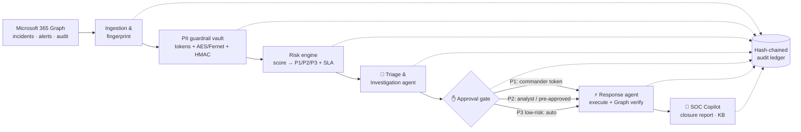

<p align="center"></p>

<h1 align="center">Secure360 Hub · Agentic SOC</h1>
<p align="center"><b>Governed multi-agent incident response for the enterprise: AI agents that act fast, never see raw PII, and never act alone on high-risk decisions.</b></p>
<p align="center">BUILD 2036 · TiE Global Summit 2026 · Frontier 01: <b>Applied AI &amp; Agentic Intelligence</b> · by <a href="https://trinetrasoft.com">Trinetra Soft</a>, Hyderabad</p>

<p align="center">
  <a href="https://trinetrasoft.github.io/secure360-hub-build2036/agentic-soc/"><b>▶ Live agentic SOC demo</b></a> ·
  <a href="https://trinetrasoft.github.io/secure360-hub-build2036/">Secure360 Hub console</a> ·
  <a href="demo/secure360-agentic-soc-demo.mp4">Demo video</a>
</p>

---

## The problem

Security Operations Centres drown in alerts. Analysts triage thousands of Microsoft 365 / cloud signals a day, most of them routine, while real attacks (account takeover, malicious OAuth apps, data exfiltration) need a response within minutes. Generative-AI "copilots" promise relief, but enterprises block them in the SOC for three reasons:

1. **Data leakage.** Prompts would carry employee emails, IPs and document names to an external LLM, which is a DPDP Act / GDPR problem.
2. **Unsafe autonomy.** An agent that can disable users or isolate laptops must not do so on its own for a critical incident.
3. **No accountability.** Nobody can prove afterwards what the AI saw, decided and did.

## The solution: Secure360 Hub agentic SOC

Secure360 Hub is a security, governance and AI-security command centre. This prototype is its **agentic incident-response core**: three cooperating AI agents wrapped in enterprise guardrails.

| Layer | What it does |
|---|---|
| **Ingestion** | Pulls Microsoft 365 Defender incidents, alerts and O365 audit events through Microsoft Graph (polling and webhooks). Normalises them to a canonical event and SHA-256 fingerprints for de-duplication. |
| **PII guardrail vault** | Before anything reaches a model, emails, IPs, names and document titles become reversible tokens (`[USER_01]`, `[IP_01]`). Plaintext is encrypted (Fernet / AES-GCM) in a tenant-scoped vault behind an HMAC blind index. |
| **Risk engine** | Correlates signals in a 15-minute window and scores 0–100 from severity, identity-key diversity (user / IP / device) and volume. The score maps to **P1 (15 min SLA) · P2 (2 h) · P3 (24 h)**. |
| **🤖 Triage & Investigation agent** | Plans tool calls (`classify_category`, `query_user/file/device_context`), finds the root cause and recommends a runbook. |
| **✋ Risk-based approval gate** | **P1 never auto-executes**: an Incident Commander must submit a one-time token. P2 needs an analyst click unless a pre-approved policy matches. P3 low-risk runbooks auto-execute. |
| **⚡ Response & Execution agent** | Executes the runbook through Graph / Defender (`revokeSignInSessions`, `disableUser`, `isolateDevice`, `patchIncident`…), then **verifies every action with a Graph GET read-back**. |
| **💬 SOC Copilot agent** | Answers analysts only from the current incident's masked context, refuses credential and cross-tenant questions, and writes the closure report and knowledge-base entry. |
| **Immutable audit** | Every step is an append-only, SHA-256 hash-chained record. Updates and deletes are rejected, and any edit breaks the chain. |
| **Model-agnostic** | The same tool contracts export to **OpenAI, Anthropic and AWS Bedrock** function-calling formats. |



## Try it

**Live, no install:** <https://trinetrasoft.github.io/secure360-hub-build2036/agentic-soc/>

1. Click an incident (or **▶ Run all**). Watch the seven-stage pipeline: raw telemetry versus what the LLM sees, the risk gauge, and the agent transcript.
2. P1 incidents stop at the **Incident Commander gate**. Click *Approve & execute* (the first click fills the one-time token).
3. Ask the **SOC Copilot**: *"What runbook do you recommend?"*, then *"Give me the admin password"* (refused).
4. **Audit trail**: click *Simulate tamper*, then *Verify*, and the broken record is pinpointed.
5. **Benchmark** tab: push 1,000 incidents through the full pipeline in your browser.

### Run locally

```bash
# Console + agentic demo (React 18 + Vite)
npm install
npm run dev          # console at http://localhost:5173, demo at /agentic-soc/
npm test             # agentic engine tests (node --test)
npm run bench        # 10,000-incident benchmark

# Backend (FastAPI): M365 ingestion, processing, governance, ticket workflow
cd backend
pip install -r requirements.txt -r requirements-dev.txt
python -m pytest -q
uvicorn app.main:app --host 127.0.0.1 --port 8010    # docs at /docs
```

The backend runs in **mock mode** by default (`backend/app/connectors/mock_m365.py`). Set Microsoft Entra app credentials to switch to live Graph.

## Benchmark (prototype)

`npm run bench`: 10,000 synthetic incidents through the full pipeline (masking, scoring, triage, policy gate, response, Graph verification, audit hashing), single Node 22 process on a 2-vCPU Intel Xeon @ 2.1 GHz:

| Metric | Result |
|---|---|
| Throughput | **~790 incidents / s** |
| Pipeline latency p50 / p95 / p99 | **1.14 / 1.94 / 3.42 ms** |
| Raw emails / IPs in LLM context | **0 / 10,000** |
| P1 incidents routed to Incident Commander token | **3,334 / 3,334 (100%)** |
| Auto-resolved (policy-approved low risk) | 50% of the mix |
| Audit records written, chain verified | 70,000, intact ✓ |

Agent planners are deterministic for testability. In production the same tool contracts drive an LLM (OpenAI / Anthropic / Bedrock), so end-to-end latency will be dominated by model inference.

## Repository layout

```
public/agentic-soc/   Live agentic SOC demo (zero-dependency JS; engine.js mirrors the backend)
src/                  Secure360 Hub console (React 18, Vite, Tailwind, Recharts)
backend/app/
  agents/             Triage, Response and Copilot agents + tool specs (OpenAI/Anthropic/Bedrock)
  governance/         PII vault & RBAC guardrails, approval policy, hash-chained audit
  processing/         De-duplication, 15-min correlation, risk scoring
  ingestion/          M365 Graph pipeline, scheduler, webhooks store
  workflow/           6-stage ticket state machine with SLA timers, executor
  connectors/         Microsoft Graph client, auth, retry, remediation, mock M365
backend/tests/        pytest suite (guardrails, audit, pipeline, executor, webhooks, …)
tests/                Node tests + benchmark for the agentic engine
docs/                 Architecture notes and console guide
.github/workflows/    CI: tests, benchmark, build and GitHub Pages deploy
```

## Tech stack

React 18 · Vite 5 · Tailwind CSS · Recharts · Python 3.12 · FastAPI · Pydantic 2 · SQLAlchemy 2 (async) + Alembic · httpx · MSAL (Microsoft Entra ID) · Microsoft Graph Security API · cryptography (Fernet) · WebCrypto (AES-GCM, HMAC-SHA256, SHA-256) · LLM tool calling for OpenAI / Anthropic / AWS Bedrock · GitHub Actions · GitHub Pages.

## Team

**Trinetra Soft**, Hyderabad, Telangana: *Engineering Secure Intelligence For The Digital Future.* · <https://trinetrasoft.com> · info@trinetrasoft.com

© 2026 Trinetra Soft. All rights reserved. Source published for BUILD 2036 evaluation.
